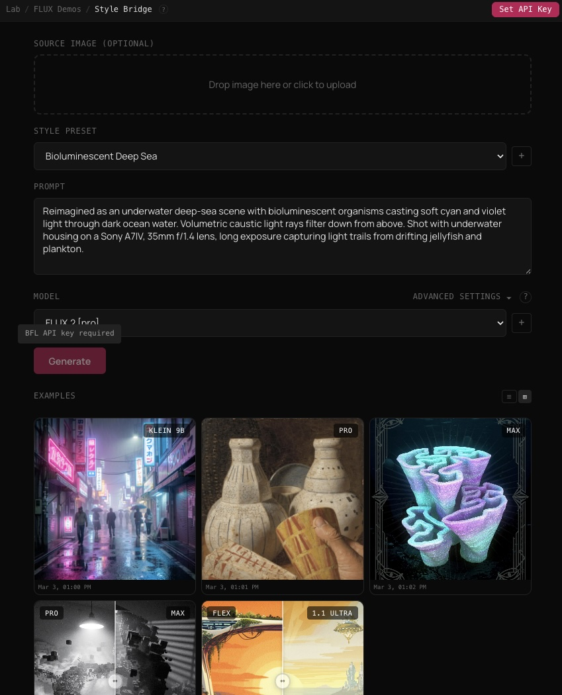
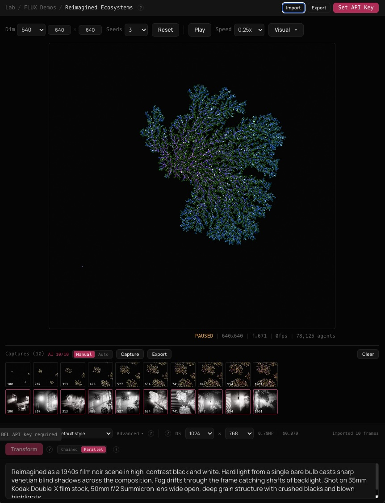

# FLUX Demos

Two interactive demos for BFL's FLUX image generation models. Vite+React+TS, deployed to Vercel.

## Demos

### FLUX Style Bridge (`/flux-style-bridge`)



Upload an image and transform it through curated style presets (bioluminescent, brutalist, Dutch masters, etc.) using FLUX img2img. Or go text-only.

- **Style DNA Mixer** — blend two style presets with a weighted slider. Each preset gets its own editable prompt textarea. Final prompt composes blending info + both style prompts.
- **A/B Model Compare** — generate the same prompt+seed on two models in parallel. Results display with a draggable comparison slider (hover on desktop, drag on mobile).
- **Example gallery** — 5 built-in examples (txt2img, img2img, style mixing, A/B compare) shown when gallery is empty so visitors without API keys can see what the tool produces.
- **Gallery persistence** — generated images are converted to base64 and stored in IndexedDB. Survives page refreshes. Storage size shown on hover. Grid/list view toggle (grid default). Delete individual entries. Model label badge on result images.
- **Compare slider** — auto-returns to center with easeInOut after 1s of no interaction.
- **Advanced settings** — union of both models' capabilities shown when comparing, with "[model] only" badges on exclusive settings. Closes on click outside.

### FLUX Reimagined Ecosystems (`/flux-reimagined-ecosystems`)



A WebGPU DLA (Diffusion-Limited Aggregation) simulation runs in real-time. Capture sequences of frames and batch-transform them via FLUX img2img.

- **Capture + AI strips** — vertically aligned strips at sim bottom (captures) and bottom panel top (AI results). Scroll-synced.
- **Batch transform** — sequential img2img of all untransformed captures. Configurable downsample (256–1024px) to reduce cost. Per-frame cost estimation based on model pricing.
- **Keyboard shortcuts** — Space (pause), C (capture), T (transform), R (reset), X (clear), E (export), \ (hold for shortcut overlay).
- **IndexedDB persistence** — session auto-saves captures + AI results. Restores on refresh.
- **Discard confirmation** — modal before destructive actions (reset/clear) when session has data.
- **Export** — ZIP download of all captures + AI images + session metadata via JSZip.
- **Visual controls** — collapsible DOF + color sliders updating GPU in real-time. Full advanced FLUX settings.

## Setup

```bash
npm install
npm run dev
```

## API Key

Users provide their own BFL API key via the in-app settings button. A key stays in the tab (`sessionStorage`) unless the visitor ticks *Remember on this device* (`localStorage`; the dialog says not on a public or shared computer), since lab.merttoka.com shares its storage with every page on the domain; it's passed through the serverless proxy and never stored server-side. The image proxy (`api/image-proxy`, for results BFL serves without CORS) fetches only FLUX results (https, `*.bfl.ai`, following a redirect only while it stays there, as result polling does with the key) and passes them on only as PNG, JPEG or WebP, going by their bytes, with `nosniff` and a sandbox CSP: it answers on lab.merttoka.com, where the key is stored. Get a key at [api.bfl.ai](https://api.bfl.ai).

## Deploy

Deployed on Vercel at `lab.merttoka.com`. Breadcrumb nav: Lab / [experiment]. The two demos are linked directly from the Lab home; `/bfl-api/` itself 308s to the Lab home there (the local `/` index page is for standalone dev only).

- `base: '/bfl-api/'` is set in `vite.config.ts` when `VERCEL` env is present
- `vercel.json` rewrites `/bfl-api/api/*` to serverless functions and `/bfl-api/*` to the SPA

No server-side environment variables needed.

## Design

UI follows the lab.merttoka.com design language: shared theme tokens (`src/theme/tokens.css`), LabHeader as the Lab's (merttoka.com's floating glass bar: logo to merttoka.com, "Lab" and the bubbling flask back to the Lab, page controls via its `tools` prop in a strip that scrolls on a phone, styled by the shared `.lab-tool`/`.lab-tool-seg` in `src/components/LabHeaderTools.css`), dark/light themes (one sun/moon button; follows the OS until clicked, then `lab.theme` = `light`/`dark`, shared with the Lab), Manrope body + mono labels, `#BF1656` accent, pill buttons, card hover lift + glow.

Home cards carry thumbnails captured from the running demos (`public/previews/<slug>/`): an 800px webp still (poster + reduced-motion fallback) and a ~5 s muted webm/mp4 loop — Style Bridge sweeps the A/B compare sliders, Reimagined Ecosystems shows DLA growth at 8×. Served under `/bfl-api/previews/` via a `vercel.json` rewrite.

## Stack
- Vite + React + TypeScript
- WebGPU (DLA simulation)
- Vercel serverless functions (BFL API proxy)
- BFL models: FLUX.2 [pro] (+ preview), [max], [flex], [klein] 9B (+ preview), [klein] 4B; FLUX1.1 [pro], [pro] Ultra. Preview endpoints are where BFL lands quality/speed improvements first. Model list lives in `src/lib/bfl.ts` (mirrored by the `ALLOWED_MODELS` allowlist in `api/generate.ts`).
- FLUX.2 [pro]/[max] upsample prompts by default; the "Prompt Upsampling" toggle maps to the API's `disable_pup` flag for them. Klein models accept `input_image` for img2img (Klein 9B up to 4 refs).
